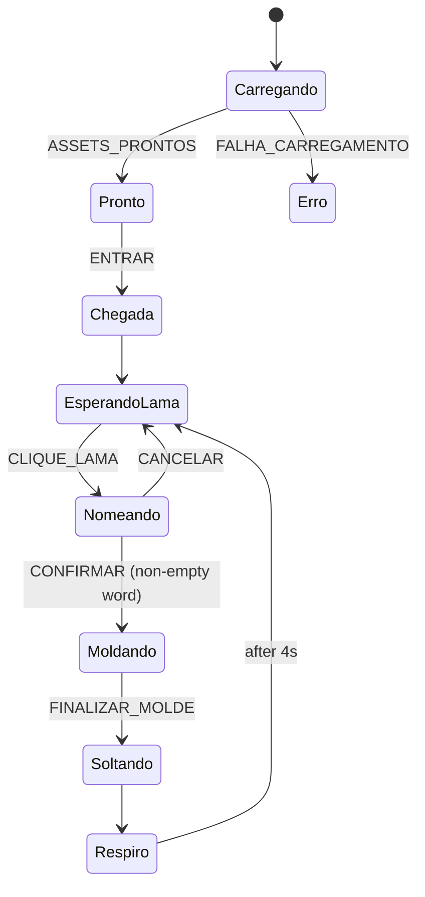

# tailwater

A riverside grounding ritual in the browser. You arrive at a river at dawn, name what is weighing on you, shape that word into a clay pot with your hands, and let it go into the water.

Real-time 3D with Three.js, driven by a state machine, with every audio asset mastered by a Python pipeline. Nothing you write ever leaves your browser.

## The ritual

1. **Arrival.** Ambient sound starts in the dark, then the scene opens.
2. **Naming.** Click the clay and write a word: something you want to let go of.
3. **Shaping.** Sculpt the clay into a pot. Each touch plays a clay sound.
4. **Release.** The pot falls into the river and dissolves.
5. **Breath.** A short pause, the word is cleared, and the river waits for the next one.

The word lives only in memory while the ritual runs. It is never stored, logged or sent anywhere.

## How it works

The project has two halves that meet at a single file: `manifest.json`.

```
sources/ (raw .wav, not in git)
    │
    ▼
atelier/  Python CLI ── trim → loudness → loop → encode
    │
    ▼
web/public/assets/generated/
    ├── audio/clay1.72d4dd3b64.m4a   (content-hashed files)
    └── manifest.json                 (what exists, where, with metadata)
    │
    ▼
web/  Vite + Three.js ── reads the manifest, loads assets, runs the ritual
```

### web: the experience

- **State machine.** The whole flow is an [XState](https://stately.ai/docs/xstate) machine (`src/ritual/ritualMachine.js`). Each step is an explicit state, and the UI only reacts to the current state. This makes impossible transitions impossible (you cannot release a pot you never shaped) and lets the flow be tested without a browser.



- **Clay.** The clay starts as an icosahedron deformed with 3D simplex noise, so every session begins with a different lump. It is sculpted in real time with the Three.js WebGPU renderer.
- **Audio.** Web Audio API. The ambience fades in and loops seamlessly. Clay sounds are throttled while dragging and get a random variation in pitch and volume on every touch, so repeated gestures do not sound mechanical. For each asset, the player tries the formats listed in the manifest in order and falls back if one fails.

### atelier: the asset pipeline

A small build tool written in Python that turns raw recordings into web-ready assets. It comes from my background in audiovisual post-production: the same mastering steps I used to do by hand, now as code.

- **Stages.** Silence trim, loudness normalization to a LUFS target (EBU R128 style), seamless loops with crossfade, and encoding to OGG and M4A.
- **Config as data.** Every sound decision lives in `atelier.toml` (targets, ceilings, crossfades, which file is what). Changing the sound means editing the config, not the code. The config is validated with Pydantic before anything runs.
- **Content hashing and caching.** Output file names carry a hash of their bytes, so browsers can cache them forever and still pick up changes. A separate cache key (source + config + tool versions) skips work that does not need redoing.
- **Manifest.** The runner writes `manifest.json` only if every stage succeeds, with each asset's files and metadata (duration, measured loudness, peak).
- **Extensible.** Every stage implements the same `Stage` protocol, and the CLI only translates commands into function calls. New stages plug in without touching the existing ones.

## Tech stack

**web:** JavaScript, Three.js (WebGPU), XState, simplex-noise, Web Audio API, Vite, Vitest
**atelier:** Python 3.12+, uv, Typer, Pydantic, NumPy, soundfile, pyloudnorm, ffmpeg, pytest, mypy (strict), Ruff
**CI/CD:** GitHub Actions, GitHub Pages

## Running locally

**web** (Node version in `web/.nvmrc`)

```bash
cd web
npm install
npm run dev
```

**atelier** (requires [uv](https://docs.astral.sh/uv/) and ffmpeg)

```bash
cd atelier
uv sync
uv run atelier build              # all stages
uv run atelier build --only audio # a single stage
```

Raw sources are not versioned. The generated assets are, so the web app runs without them.

## Quality checks

```bash
./scripts/ci.sh
```

Runs the same checks as CI: Ruff lint and format, mypy in strict mode, web tests and production build. On every push, GitHub Actions runs these checks and, on `main`, deploys the site to GitHub Pages.

## Roadmap

- [x] Clay sculpting with sound
- [x] Ritual state machine (arrival, naming, shaping)
- [x] Audio pipeline with manifest and caching
- [ ] Release scene: pot falling and dissolving in the river
- [ ] Time-of-day presets (ambience and light follow the user's clock)
- [ ] `look` stage: color grading and procedural terrain generated by the atelier
- [ ] The two cats

## Author

**Maria Cesarotti** · Software developer, former colorist and post-production supervisor · [GitHub](https://github.com/mariacesarotti)
